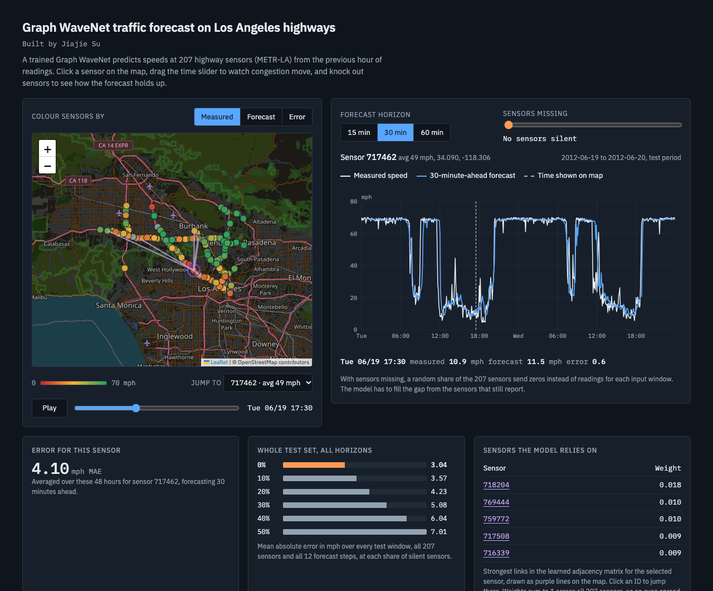

# Graph WaveNet traffic forecast viewer

An interactive page that shows what a trained [Graph WaveNet](https://arxiv.org/abs/1906.00121) predicts for highway
traffic in Los Angeles, next to the speeds that were actually measured. Built by Jiajie Su.

**Live demo: https://coliner-jiajie.github.io/graph-wavenet-traffic-demo/**



The model forecasts speed at 207 loop-detector sensors (the METR-LA dataset) from the previous hour of readings.
In the page you can:

- click any of the 207 sensors on a street map of Los Angeles to see its measured and forecast speed over two days;
- drag the time slider, or press Play, to watch congestion build and clear across the map, with sensors coloured by
  measured speed, forecast speed, or forecast error;
- choose a forecast horizon of 15, 30 or 60 minutes;
- silence 0 to 50% of the sensors and watch the forecast degrade, using the same masking as the robustness test;
- see which sensors the learned adjacency matrix links most strongly to the selected one, drawn as lines on the map.

Nothing is computed in the browser. The predictions in `data/demo_data.json` were produced by running the model
once for every sensor, and the page is a single static HTML file (about 6 MB, mostly the packed predictions).

## Results behind the page

Whole test set (6,850 windows, all 12 forecast steps), mean absolute error in mph:

| Sensors silent | 0% | 10% | 20% | 30% | 40% | 50% |
|---|---|---|---|---|---|---|
| MAE | 3.04 | 3.57 | 4.23 | 5.08 | 6.04 | 7.01 |
| RMSE | 6.10 | 6.71 | 7.45 | 8.39 | 9.44 | 10.37 |

Masking zeroes the whole input history of a random share of sensors for each input window, with a fixed random seed.
Numbers move a little with the seed.

The window shown is Tuesday 2012-06-19 and Wednesday 2012-06-20, the Tuesday-start window with the most complete sensor
data in the test period. Errors for a single sensor over that window differ from the whole-test-set figures.

## Run it

Use the live page above, open `docs/index.html` in any browser, or serve the folder:

```
python3 -m http.server 8765 --directory docs
```

The page loads two fonts from Google Fonts and the map tiles from OpenStreetMap. Without a network connection it falls back
to system fonts and a plain background, and the sensors and charts still work.

## Rebuild or re-export

Build the page from the source, data and the bundled Leaflet files (standard library only):

```
python3 scripts/build.py
```

Regenerate the data from the model. This needs PyTorch and the original Graph WaveNet code and data:

```
git clone https://github.com/nnzhan/Graph-WaveNet ../Graph-WaveNet   # then prepare METR-LA as its README describes
pip install -r requirements-export.txt
python scripts/fetch_locations.py        # sensor coordinates, only needed once
python scripts/export_data.py            # fast
python scripts/export_data.py --full     # also recompute the whole-test-set numbers, about 15 minutes on CPU
```

Set `GWNET_REPO` or `GWNET_CKPT` to use a different clone or checkpoint.

## Layout

```
docs/index.html            built page, served by GitHub Pages from /docs
src/template.html          page source (HTML, CSS, JavaScript)
data/demo_data.json        exported predictions for all 207 sensors, two days, three horizons, six masking levels
data/sensor_locations.csv  sensor coordinates from the DCRNN repository
data/full_test_summary.json   whole-test-set MAE and RMSE per masking level
scripts/build.py           inlines the data and Leaflet into the template
scripts/fetch_locations.py downloads the sensor coordinates
vendor/                    Leaflet 1.9.4 (BSD 2-Clause), inlined into the built page
scripts/export_data.py     runs the checkpoint and writes the data files
checkpoint/                trained weights used for the export (1.2 MB)
```

## Credits and data

- Model: Z. Wu, S. Pan, G. Long, J. Jiang, C. Zhang, *Graph WaveNet for Deep Spatial-Temporal Graph Modeling*, IJCAI 2019.
  The model code used to export the data is the authors' PyTorch implementation, released under the MIT license at
  https://github.com/nnzhan/Graph-WaveNet. This project does not include that code.
- Map: [Leaflet](https://leafletjs.com) 1.9.4 (BSD 2-Clause, see `vendor/LEAFLET-LICENSE`) and map data © OpenStreetMap contributors.
- Sensor coordinates: the DCRNN repository by Li et al. (MIT license), https://github.com/liyaguang/DCRNN.
- Data: METR-LA, 5-minute speed readings from 207 loop detectors on Los Angeles County highways, as prepared by
  Li et al., *Diffusion Convolutional Recurrent Neural Network*, ICLR 2018. The raw data is not included here.
- The checkpoint was trained for a course project (UCI EECS 298E, Winter 2026).
- This viewer was built with AI assistance (Claude).

## License

MIT, see `LICENSE`. This covers the viewer, the scripts and the exported data files. The Graph WaveNet model code
is separate and carries its own MIT license from its authors. METR-LA data keeps the terms of its original release.
